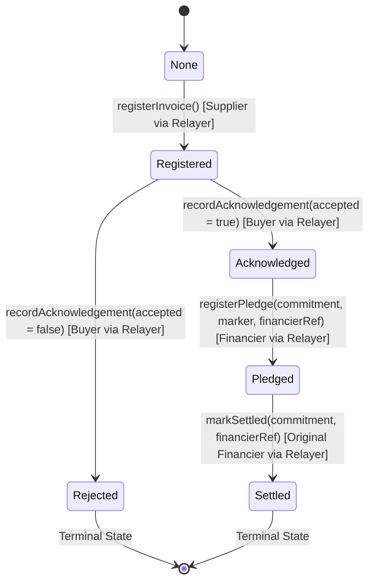

# Stock & Foil

> **"Finance the invoice. Not the fraud."**  
> *A privacy-preserving receivables-financing registry powered by the MST Blockchain.*  
> **MST Blockchain Buildathon #2 Submission**

[](https://testnet.mstscan.com/address/0x9a1559F1bCc8dd80c34a1F4706c66d897722dfEE)
[-blue)](https://soliditylang.org/)
[](LICENSE)
[](contracts/)
[](chain/)

---

## 1. Executive Summary & Problem Statement

### The Problem: Invoice Double-Financing Fraud
In trade and receivables financing, small and medium enterprises (SMEs) finance unpaid invoices through banks and alternative financiers to unlock working capital. However, bad actors frequently pledge the **exact same invoice to multiple lenders simultaneously** (double-pledging / duplicate financing). 

Because traditional registries and ERPs are fragmented across proprietary silos, lenders have no shared, real-time mechanism to detect duplicate pledges without leaking sensitive commercial data (client lists, unit pricing, bank accounts, and margins).

### The Solution: Stock & Foil
**Stock & Foil** eliminates invoice fraud while preserving complete commercial secrecy:
- **Zero On-Chain PII**: No invoice amounts, numbers, buyer names, or tax IDs are ever stored on-chain.
- **Cryptographic Blind Commitments**: Invoices are represented as deterministic, salted cryptographic hashes.
- **Atomic Duplicate Pledge Prevention**: The smart contract computes an invariant `pledgeMarker` on-chain and enforces single-pledge uniqueness at the EVM state level. Any second financing attempt on the same commitment is immediately reverted.
- **Three-Party Lifecycle Verification**: Only invoices explicitly verified and acknowledged by the buyer can be financed by a lender.

---

## 2. MST Blockchain Testnet Deployment

The `StockFoilRegistry` smart contract is live and verified on the official **MST Blockchain Testnet**.

| Parameter | Value |
|---|---|
| **Network Name** | MST Blockchain Testnet |
| **Chain ID** | `91562037` (Hex: `0x5752035`) |
| **RPC Endpoint** | `https://testnetrpc.mstblockchain.com` |
| **Block Explorer** | [https://testnet.mstscan.com](https://testnet.mstscan.com) |
| **Contract Address** | [`0x9a1559F1bCc8dd80c34a1F4706c66d897722dfEE`](https://testnet.mstscan.com/address/0x9a1559F1bCc8dd80c34a1F4706c66d897722dfEE) |
| **Deployer & Relayer Wallet** | [`0x985FF2cf53D7908D5ecfAa0808ecC0e432bD4d68`](https://testnet.mstscan.com/address/0x985FF2cf53D7908D5ecfAa0808ecC0e432bD4d68) |
| **Deployment Manifest** | [`contracts/deployments/mstTestnet.json`](contracts/deployments/mstTestnet.json) |

### Live On-Chain Verification Trail

The full 5-stage lifecycle was executed and verified live against the MST Testnet contract (`contracts/scripts/smoke-test-mst.ts`):

| Lifecycle Phase | Function | Block | Tx Hash | Result |
|---|---|---|---|---|
| **1. Registration** | `registerInvoice` | `6694141` | [`0xdaa9911f9ae6...`](https://testnet.mstscan.com/tx/0xdaa9911f9ae67408d54a2362da0726575afda4e1510461e29980ef7d8cf2ae1d) | **Confirmed** (State = Registered) |
| **2. Acknowledgement** | `recordAcknowledgement` | `6694142` | [`0xc38becfba158...`](https://testnet.mstscan.com/tx/0xc38becfba158afb4559f584537a4df488b6afc1aac0a156afab06b515255392b) | **Confirmed** (State = Acknowledged) |
| **3. Financing Pledge** | `registerPledge` | `6694144` | [`0xe5f7bee5dd1c...`](https://testnet.mstscan.com/tx/0xe5f7bee5dd1c1e983c29295171ada4b4e605a2583efe7a898a274a169a4053ed) | **Confirmed** (State = Pledged, Marker Active) |
| **4. Fraud Attempt (Duplicate)** | `registerPledge` | - | *Reverted On-Chain* | **REVERTED:** `PledgeMarkerAlreadyUsed()` |
| **5. Loan Settlement** | `markSettled` | `6694147` | [`0x5bbfa4714c9a...`](https://testnet.mstscan.com/tx/0x5bbfa4714c9af10ed423c795869f780a5b741672b695dfaf4c5395ac12994abe) | **Confirmed** (State = Settled) |

---

## 3. Cryptographic Architecture & Trust Model

### 3.1 Blind Invoice Commitments
Commercial data remains strictly in off-chain encrypted storage (AES-256-GCM). The chain only observes an opaque 32-byte Keccak-256 hash constructed with a high-entropy 256-bit salt:

```solidity
commitment = keccak256(abi.encodePacked(
    "STOCKFOIL_INVOICE_V1",
    salt,              // bytes32: 256-bit random salt
    invoiceNumber,     // string: Normalized invoice identifier
    supplierTaxId,     // string: Normalized supplier registration
    buyerTaxId,        // string: Normalized buyer registration
    currency,          // string: ISO 4217 (e.g. "USD")
    amountInCents,     // uint64: Invoice value
    issueDate,         // string: YYYY-MM-DD
    dueDate            // string: YYYY-MM-DD
));
```

### 3.2 Counterparty & Role Pseudonyms
Actors are represented on-chain via one-way blinded identity hashes:
```solidity
actorRef = keccak256(abi.encodePacked("STOCKFOIL_USER_V1:", userId));
```

### 3.3 Atomic Pledge Marker & Anti-Replay Guarantee
To eliminate double-financing, the registry binds financing pledges to an immutable derived marker:
```solidity
pledgeMarker = keccak256(abi.encodePacked("STOCKFOIL_PLEDGE_V1", commitment));
```
Inside `registerPledge(...)`:
1. The contract re-computes `expectedMarker = computePledgeMarker(commitment)` and verifies `expectedMarker == pledgeMarker`.
2. It verifies `!pledgeMarkerUsed[pledgeMarker]` and `record.state == State.Acknowledged`.
3. In a single atomic step (**Checks-Effects-Interactions**), it sets `pledgeMarkerUsed[pledgeMarker] = true` and `record.state = State.Pledged`.
4. Any competing transaction attempting to pledge the same commitment in the same block or a subsequent block is rejected.

---

## 4. On-Chain State Machine



### State Definitions
- `0: None` — Unregistered commitment.
- `1: Registered` — Supplier registered invoice commitment; pending buyer verification.
- `2: Acknowledged` — Buyer confirmed invoice validity and payment terms. Eligible for financing.
- `3: Rejected` — Buyer disputed or rejected invoice. Terminal state; financing is permanently locked.
- `4: Pledged` — Financier has funded the invoice. Duplicate pledges strictly blocked.
- `5: Settled` — Financier confirmed loan repayment. Terminal state.

---

## 5. System Architecture & Tech Stack

```
+-------------------------------------------------------------------------+
|                              STOCK & FOIL                               |
+-------------------------------------------------------------------------+
|  Frontend (React + Vite + Tailwind CSS + Lucide Icons)                  |
|  - Supplier Portal: Register invoices, download audit certificates      |
|  - Buyer Portal: Review & acknowledge/reject invoices                   |
|  - Financier Portal: Inspect registry status, pledge funding, settle   |
+------------------------------------+------------------------------------+
                                     | REST API (JSON + Bearer JWT)
+------------------------------------+------------------------------------+
|  Backend (Node.js + Express + PostgreSQL / PGlite)                      |
|  - AES-256-GCM off-chain document & salt encryption                    |
|  - Commitment generation & verification engine                          |
|  - Automated reconciliation & custodial relayer queue                   |
+------------------------------------+------------------------------------+
                                     | TypeScript Chain Adapter (@stockfoil/chain)
+------------------------------------+------------------------------------+
|  MST Blockchain Integration Layer                                       |
|  - EvmAdapter: Fresh nonce tracking, safe gas buffers (gasLimit: 300k)  |
|  - Paris EVM bytecode compatibility (zero PUSH0 opcodes)                |
|  - MockAdapter: Zero-latency deterministic fallback for CI/CD           |
+------------------------------------+------------------------------------+
                                     | JSON-RPC (https://testnetrpc.mstblockchain.com)
+------------------------------------+------------------------------------+
|  MST Blockchain Testnet (Chain ID: 91562037)                           |
|  - StockFoilRegistry.sol (0x9a1559F1bCc8dd80c34a1F4706c66d897722dfEE)   |
+-------------------------------------------------------------------------+
```

### Technology Highlights
- **Smart Contracts**: Solidity `0.8.24` with `evmVersion: "paris"` to guarantee complete opcode compatibility on young EVM networks.
- **Access Control**: OpenZeppelin `AccessControl` (`DEFAULT_ADMIN_ROLE` and `OPERATOR_ROLE`).
- **Chain Package (`@stockfoil/chain`)**: Independent TypeScript package conforming to Section 6 of the project contract with a unified interface for both `EvmAdapter` and `MockAdapter`.
- **EVM Gas Engineering**: Explicit `gasLimit: 300000` overrides to avoid tight gas estimation edge cases on testnet nodes.

---

## 6. Monorepo Structure

```
stock-foil/
├── chain/                         # @stockfoil/chain package
│   ├── src/
│   │   ├── EvmAdapter.ts          # Ethers v6 live EVM chain adapter
│   │   ├── MockAdapter.ts         # In-memory test/preview mock adapter
│   │   ├── createChainAdapter.ts  # Dynamic adapter factory
│   │   └── types.ts               # Core ChainAdapter interface & types
│   └── __tests__/                 # Vitest conformance test suite (26 tests)
│
├── contracts/                     # Hardhat smart contract workspace
│   ├── contracts/
│   │   └── StockFoilRegistry.sol  # Core privacy-preserving registry
│   ├── deployments/
│   │   └── mstTestnet.json        # Verified deployment parameters & addresses
│   ├── scripts/
│   │   ├── deploy.ts              # MST testnet deployment script
│   │   ├── smoke-test-mst.ts      # Live on-chain smoke verification test
│   │   └── demo-local.ts          # Local demo & duplicate prevention replay
│   └── test/                      # Hardhat test suite (25 tests, 100% coverage)
│
├── backend/                       # Express API & cryptographic services
│   ├── src/
│   │   ├── routes/                # Invoices, auth, pledges, internal reconcile
│   │   ├── services/              # Commitment hashing, encryption, DB
│   │   └── db/                    # PostgreSQL migrations & PGlite fallback
│   └── .env.example
│
├── frontend/                      # React + Vite application
│   └── src/                       # Role dashboards, modals, state management
│
├── docs/                          # Comprehensive technical specs
│   ├── CHAIN.md                   # Full blockchain architecture specification
│   ├── CONTRACT.md                # Multi-developer integration contract (v1)
│   ├── API.md                     # Backend REST API specification
│   └── commitment-vectors.json    # Shared cryptographic test vectors
│
├── vercel.json                    # Monorepo deployment routing configuration
└── README.md
```

---

## 7. Test Results & Verification

### Smart Contract Test Suite (`npm run test -w contracts`)
- **25 / 25 Passing Tests**:
  - Access control and zero-address constructor guards.
  - Complete 5-phase lifecycle test (`Register -> Acknowledge -> Pledge -> Settle`).
  - Terminal buyer rejection behavior.
  - Custom error revert verifications (`ZeroValue`, `AlreadyRegistered`, `WrongState`, `NotBuyer`, `NotFinancier`, `PledgeMarkerAlreadyUsed`, `UnknownCommitment`).
  - Same-block race condition simulation with automine off (two simultaneous pledges; first succeeds, second reverts with `PledgeMarkerAlreadyUsed`).
  - 100% parity against shared vectors in `docs/commitment-vectors.json`.
  - Fuzzing & invariant test suite (10 randomized cycles).

### Smart Contract Code Coverage (`npm run coverage -w contracts`)
```
------------------------|----------|----------|----------|----------|----------------|
File                    |  % Stmts | % Branch |  % Funcs |  % Lines |Uncovered Lines |
------------------------|----------|----------|----------|----------|----------------|
 contracts\             |      100 |      100 |      100 |      100 |                |
  StockFoilRegistry.sol |      100 |      100 |      100 |      100 |                |
------------------------|----------|----------|----------|----------|----------------|
All files               |      100 |      100 |      100 |      100 |                |
------------------------|----------|----------|----------|----------|----------------|
```

### Chain Adapter Conformance Suite (`npm run test -w chain`)
- **26 / 26 Passing Tests**:
  - `MockAdapter` and `EvmAdapter` share the identical conformance test suite.
  - Verifies identical error code normalization (`WRONG_STATE`, `PLEDGE_MARKER_USED`, `UNAUTHORIZED`, `NOT_FOUND`).
  - Verifies event queries and pending transaction timeout handling.

---

## 8. Getting Started & Local Development

### Prerequisites
- Node.js `v18.0.0` or higher
- npm `v9.0.0` or higher
- Git

### Installation
Clone the repository and install dependencies across all workspaces:
```bash
git clone https://github.com/lobhastidke/stock-and-foil.git
cd stock-foil
npm install
```

### Environment Configuration
Copy `.env.example` to `.env`:
```bash
cp .env.example .env
```

To run against the live **MST Blockchain Testnet**:
```ini
NODE_ENV=development
PORT=3001

# Authentication & Encryption Keys (Generate with: openssl rand -hex 32)
JWT_SECRET=0123456789abcdef0123456789abcdef0123456789abcdef0123456789abcdef
DOC_ENCRYPTION_KEY=0123456789abcdef0123456789abcdef0123456789abcdef0123456789abcdef
CRON_SECRET=stockfoil_dev_cron_secret_12345

# Blockchain Mode (MST Testnet)
CHAIN_MODE=MST_TESTNET
CHAIN_RPC_URL=https://testnetrpc.mstblockchain.com
CHAIN_ID=91562037
CONTRACT_ADDRESS=0x9a1559F1bCc8dd80c34a1F4706c66d897722dfEE
OPERATOR_PRIVATE_KEY=<your_metamask_private_key>

VITE_API_BASE=/api/v1
```

*(Note: For offline local testing without testnet tokens, set `CHAIN_MODE=MOCK`.)*

### Running the Test Suites
```bash
# 1. Run smart contract unit & fuzz tests
npm run test -w contracts

# 2. Run smart contract coverage
npm run coverage -w contracts

# 3. Run chain adapter conformance tests
npm run test -w chain

# 4. Run backend tests
npm run test -w backend
```

### Running the Live On-Chain MST Testnet Smoke Test
Execute the full 5-step lifecycle directly on the live MST Testnet:
```bash
npx hardhat run scripts/smoke-test-mst.ts --network mstTestnet --cwd ./contracts
```

### Running the Local Anti-Fraud Demo
```bash
npm run demo:local -w contracts
```

### Starting the Application Locally
```bash
# Run both backend and frontend concurrently
npm run dev
```
- Frontend UI: `http://localhost:5173`
- Backend API: `http://localhost:3001/api/v1`

---

## 9. Security & Limitations Disclosures

1. **Custodial-Relayer Trust Model**: Users interact with the application through authenticated web sessions; transactions are signed and submitted to the MST Blockchain by the backend operator account. The blockchain guarantees tamper-proof state transitions and single-pledge uniqueness; it does not prove individual user wallet signatures.
2. **Non-Payable Smart Contract**: The smart contract does not hold, transfer, or escrow funds (`ETH` or tokens). Financial settlement takes place off-chain via fiat or institutional rails; only the irrevocable state flags are registered on-chain.
3. **Commitment Binding**: If a supplier changes an invoice field (such as the invoice amount or due date), the resulting commitment hash changes. Invoices must be agreed upon by buyer and supplier before commitment registration.

---

## 10. License

This project is licensed under the MIT License — see the [LICENSE](LICENSE) file for details.
