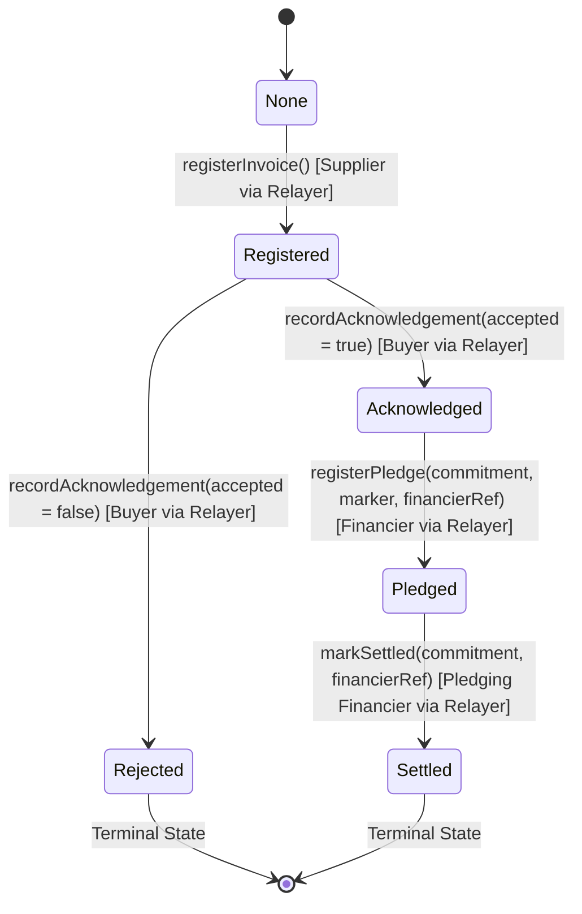

# Stock & Foil — Blockchain Registry & Chain Architecture (`docs/CHAIN.md`)

**Owner:** Member 3 (Solidity Contracts, Chain Adapter, and MST Integration)  
**Contract Version:** v1 (`docs/CONTRACT.md`)  
**Status:** Tested & Verified Locally (Hardhat & `@stockfoil/chain`)

---

## 1. Executive Summary

Stock & Foil ("*Finance the invoice. Not the fraud.*") is a privacy-preserving receivables-financing registry for the MST Blockchain Buildathon #2.

The on-chain component serves as an immutable, tamper-proof state machine that:
1. Records invoice commitments without exposing underlying financial data or Personally Identifiable Information (PII).
2. Verifies buyer acknowledgement before an invoice can be financed.
3. **Strictly and atomically rejects double-financing (duplicate pledges)** on the same commitment.
4. Records settlement once advance funding is repaid.

---

## 2. Smart Contract Architecture (`contracts/contracts/StockFoilRegistry.sol`)

### 2.1 Design Principles
- **Minimalist & Privacy-Preserving**: Only cryptographic hashes (`bytes32 commitment`, `bytes32 pledgeMarker`, `bytes32 supplierRef`, `bytes32 buyerRef`, `bytes32 financierRef`), state enums, and timestamps are stored on-chain.
- **Strictly Non-Payable**: The contract handles zero ETH or native tokens, completely eliminating reentrancy vulnerabilities and financial custody risks.
- **Immutable & Non-Upgradeable**: No upgradeable proxy contracts (ERC-1967/UUPS) are used. Proxies introduce admin centralization and trust assumptions. An immutable contract provides predictable, tamper-proof registry guarantees for a student buildathon project.
- **Checks-Effects-Interactions**: All state mutations (`pledgeMarkerUsed[marker] = true` and `record.state = State.Pledged`) happen atomically within the same transaction before any external interaction.

### 2.2 Compiler & EVM Configuration
- **Solidity Version**: `0.8.24`
- **Target EVM Version**: `paris`
  > **Crucial Engineering Decision:** Solidity 0.8.20 and newer default to the `shanghai` EVM version which introduces the `PUSH0` opcode. Many newer, Layer-2, and alternative EVM chains (such as MST Testnet) do not yet support `PUSH0`. Locking `evmVersion: "paris"` in `hardhat.config.ts` guarantees compatibility across all EVM environments without bytecode execution failures.

### 2.3 Roles & Access Control
The contract utilizes OpenZeppelin's `AccessControl`:
- `DEFAULT_ADMIN_ROLE`: Assigned to the deployer; manages role grants.
- `OPERATOR_ROLE`: Assigned to the backend custodial relayer account. Only accounts with `OPERATOR_ROLE` may invoke state-mutating functions (`registerInvoice`, `recordAcknowledgement`, `registerPledge`, `markSettled`).

### 2.4 The Custodial-Relayer Trust Model
**Honest Architectural Disclosure**: Users (Suppliers, Buyers, Financiers) interact with the backend API via authenticated sessions. The backend's operator private key signs and submits transactions to the blockchain. Therefore:
- The blockchain proves that the **Stock & Foil Registry recorded these state transitions at specific blocks/times**.
- The blockchain does **not** cryptographically prove that individual counterparty wallets signed the transactions directly.

---

## 3. On-Chain State Machine & Transitions



### State Rules
1. `registerInvoice`: Commitment must not be zero and must currently be `None`. Sets state to `Registered`.
2. `recordAcknowledgement`: Commitment must be in `Registered` state. Caller's `buyerRef` must match the registered `buyerRef`. Sets state to `Acknowledged` (if `accepted = true`) or `Rejected` (if `accepted = false`).
3. `registerPledge`:
   - Commitment must be in `Acknowledged` state.
   - The provided `pledgeMarker` **must strictly equal** `keccak256(abi.encodePacked("STOCKFOIL_PLEDGE_V1", commitment))`.
   - If `pledgeMarkerUsed[pledgeMarker] == true`, transaction reverts with `PledgeMarkerAlreadyUsed()`.
   - Updates `pledgeMarkerUsed[pledgeMarker] = true` and `record.state = State.Pledged` atomically.
4. `markSettled`: Commitment must be in `Pledged` state. Caller's `financierRef` must match the recorded `financierRef`. Sets state to `Settled`.
5. `Rejected` and `Settled` are terminal. No further transitions are permitted.

---

## 4. Replay & Double-Pledge Prevention

Stock & Foil prevents double-financing attacks through two independent layers:
1. **Deterministic One-Time Pledge Marker**:
   ```solidity
   function computePledgeMarker(bytes32 commitment) public pure returns (bytes32) {
       return keccak256(abi.encodePacked("STOCKFOIL_PLEDGE_V1", commitment));
   }
   ```
   Because each commitment generates exactly one deterministic marker, registering a pledge consumes that marker globally (`pledgeMarkerUsed[marker] = true`).
2. **Same-Block Race Protection**:
   Even if two financiers submit competing pledge transactions in the very same block, the Ethereum Virtual Machine executes transactions sequentially within the block. The first transaction consumes the marker; the second transaction immediately reverts with `PledgeMarkerAlreadyUsed()`. This was proven via Hardhat automining tests (`contracts/test/StockFoilRegistry.test.ts`).

---

## 5. Solidity Custom Errors & Adapter Mapping

To optimize gas and provide deterministic error handling across TypeScript and Solidity, custom errors are used throughout:

| Solidity Custom Error | Revert Condition | `@stockfoil/chain` `TxErrorCode` | HTTP Status (API) |
| :--- | :--- | :--- | :--- |
| `ZeroValue()` | Zero address or zero bytes32 provided | `WRONG_STATE` | `400 VALIDATION_ERROR` |
| `AlreadyRegistered()` | Commitment already registered in contract | `WRONG_STATE` | `409 CONFLICT` |
| `WrongState()` | Action invalid for current invoice state | `WRONG_STATE` | `409 INVALID_TRANSITION` |
| `UnknownCommitment()` | Commitment does not exist in registry | `NOT_FOUND` | `404 NOT_FOUND` |
| `NotBuyer()` | Acknowledgement submitted with wrong buyerRef | `UNAUTHORIZED` | `403 FORBIDDEN` |
| `NotFinancier()` | Settlement attempted by wrong financierRef | `UNAUTHORIZED` | `403 FORBIDDEN` |
| `InvalidPledgeMarker()` | Provided marker != `computePledgeMarker(cmt)` | `WRONG_STATE` | `422 COMMITMENT_MISMATCH` |
| `PledgeMarkerAlreadyUsed()` | Commitment already pledged (double-financing) | `PLEDGE_MARKER_USED` | `409 DUPLICATE_PLEDGE` |
| `AccessControlUnauthorizedAccount` | Call made by non-operator address | `UNAUTHORIZED` | `403 FORBIDDEN` |

---

## 6. Local Setup, Deployment & Testing

### 6.1 Running Smart Contract Tests & Coverage
From repository root:
```bash
# 1. Run full Hardhat test suite (25 tests covering lifecycle, fuzzing, and race conditions)
npm run test -w contracts

# 2. Run code coverage (Achieves 100% Statements, 100% Branch Coverage, 100% Lines)
npm run coverage -w contracts
```

### 6.2 Running Local Hardhat Node & Deployment
```bash
# 1. Start local Hardhat node in terminal 1
npx hardhat node --cwd ./contracts

# 2. Deploy registry contract to local node in terminal 2
npx hardhat run scripts/deploy.ts --network localhost --cwd ./contracts
```
The deploy script outputs contract address and saves metadata to `contracts/deployments/localhost.json`.

### 6.3 Running Local Double-Pledge Demonstration
```bash
npm run demo:local -w contracts
```
This script executes the complete lifecycle on a local Hardhat provider and intentionally attempts a double-financing fraud attack, demonstrating real-time transaction rejection.

---

## 7. Chain Package (`@stockfoil/chain`)

The `@stockfoil/chain` workspace package provides a single unified `ChainAdapter` interface for Member 2's backend:

```ts
import { createChainAdapter } from '@stockfoil/chain';

const adapter = createChainAdapter(); // Picks mode from CHAIN_MODE env var
```

### 7.1 Modes Supported
1. `MOCK`: In-memory state machine implementing 100% identical state transitions, errors, and marker uniqueness without network calls. Ideal for local unit testing and Vercel serverless preview environments.
2. `HARDHAT`: Connects via ethers v6 to local Hardhat node.
3. `MST_TESTNET`: Connects via ethers v6 to official MST Testnet using verified environment variables (`CHAIN_RPC_URL`, `CHAIN_ID`, `CONTRACT_ADDRESS`, `OPERATOR_PRIVATE_KEY`).

### 7.2 Running Conformance Tests
The conformance suite tests both `MockAdapter` and `EvmAdapter` against the exact same assertions:
```bash
npm run test -w chain
```

---

## 8. Honest Limitations & Disclosures

1. **Registry Scope**: Duplicate pledge prevention functions **only within this Stock & Foil registry**. It cannot prevent an invoice from being pledged on an independent, disconnected external platform.
2. **Authenticity**: A cryptographic commitment, buyer acknowledgement, or blockchain transaction does **not** legally verify invoice authenticity, real-world goods delivery, or creditworthiness.
3. **Custodial Operator**: The blockchain records transactions signed by the backend relayer operator key, confirming registry-level consensus.
4. **No Native Escrow**: Funding is simulated off-chain. No fiat or ERC-20 transfers take place on the registry contract.

---

## 9. Official MST Testnet Specification & Verification Report

*Verified against official documentation at [mstblockchain.com](https://mstblockchain.com) and [chainlist.org](https://chainlist.org/chain/4545).*

| Parameter | Official Value | Verification Source |
| :--- | :--- | :--- |
| **Network Name** | `MST Testnet` | Official MST Documentation |
| **Chain ID** | `4545` (Hex: `0x11c1`) | [mstblockchain.com](https://mstblockchain.com), [chainlist.org](https://chainlist.org) |
| **Currency Symbol** | `tMSTC` | MST Testnet Spec |
| **RPC Endpoint** | `https://testnetrpc.mstblockchain.com` | Official MST RPC Gateway |
| **Block Explorer** | `https://testnet.mstscan.com` | Official MST Scan Explorer |
| **Official Faucet** | `https://mstblockchain.com` | Official Testnet Faucet Portal |
| **EVM Target** | `paris` | Standard EVM compatibility (no PUSH0 opcode dependency) |

### Deployment Command for MST Testnet
Once a dedicated testnet operator key is funded via the official faucet, deploy via:
```bash
npx hardhat run scripts/deploy.ts --network mstTestnet --cwd ./contracts
```
The deploy script saves the verified contract address and ABI to `contracts/deployments/mstTestnet.json`.

---

## 10. Operational Procedures & Disaster Recovery

### 10.1 Stuck PENDING Transactions
Because the backend relayer writes an idempotency key and initiates an on-chain transaction:
- The `EvmAdapter` waits up to 4 seconds for 1 confirmation; if network latency delays mining, it returns status `'PENDING'` with the `txHash`.
- The background Vercel cron (`POST /api/v1/internal/reconcile` every 5 minutes) calls `adapter.getTxStatus(txHash)`.
- If mined successfully, the backend marks the transaction `'CONFIRMED'`.
- If the transaction was dropped or reverted on-chain, reconciliation marks it `'FAILED'` and frees the idempotency lock.

### 10.2 Relayer Key Rotation
If the `OPERATOR_PRIVATE_KEY` is ever compromised:
1. The admin account (`DEFAULT_ADMIN_ROLE`) invokes `grantRole(OPERATOR_ROLE, newOperatorAddress)` on the registry contract.
2. The admin invokes `revokeRole(OPERATOR_ROLE, oldOperatorAddress)`.
3. Update `OPERATOR_PRIVATE_KEY` in Vercel environment variables. No contract redeployment or state migration is needed!

### 10.3 Emergency Fallback to MOCK Mode
If the testnet RPC experiences an extended outage, set `CHAIN_MODE=MOCK` in Vercel environment variables. The application immediately falls back to in-memory/database mock mode, ensuring zero downtime for live demonstrations.

